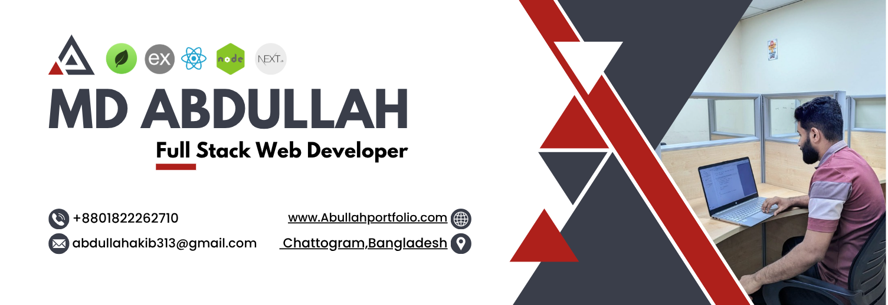

# Assalamu Alaikum! I'm Abdullah Al Akib 👋🏻

### 💻 Full-Stack Software Engineer | AI-Integrated Application Developer

🎓 B.Sc. in Computer Science & Engineering, Premier University, Chittagong  
💼 Software Engineer at Smart Framework  
🚀 Building scalable web applications and AI-powered solutions  
🧠 Interested in Artificial Intelligence, Deep Learning & Software Engineering  
📍 Chittagong, Bangladesh  

🔗 [LinkedIn](https://www.linkedin.com/in/abdullah-al-akib-a560b0247/) • [GitHub](https://github.com/abdullahallakib)

---

## 💼 About Me

I'm a Computer Science and Engineering graduate with practical experience in full-stack web development and building software applications.

I enjoy developing modern, user-focused applications, working with backend systems, integrating AI APIs, and solving real-world technical problems.

- 💻 Experienced in building full-stack applications using React.js, Next.js, Node.js and Express.js.
- 🤖 Experienced in integrating OpenAI and Google Gemini APIs into applications.
- 🗄️ Familiar with database design, REST APIs, authentication and role-based access control.
- 🛠️ Interested in software architecture, application performance and problem-solving.
- 🌱 Continuously learning and improving my software engineering skills.

## 💻 Tech Stack

### Programming Languages

### Frontend Development

### Backend Development

### Database & Authentication

### AI & Machine Learning

### Cloud, DevOps & Tools

---

## 🚀 Featured Projects

### 1. AutoQgen
**Intelligent Question and Assessment Management System**

An AI-powered examination paper generation platform developed as my undergraduate thesis project.

- Automated question and assessment paper generation.
- AI integration for question generation and validation.
- Supports multiple question formats and languages.
- Role-based access control and multi-tenant architecture.
- Built with Next.js, TypeScript, MongoDB and AI APIs.

🔗 [Live Project](https://autoqgen-seven.vercel.app/) • [GitHub Repository](https://github.com/autoqgen/autoQgen)

### 2. OwnFood
**Food Delivery Platform**

Worked on frontend interfaces, food catalogs, search and filtering functionality, and backend API integration.

### 3. Crime24TV
**Online News Portal**

Worked on responsive UI development, dynamic news content and PHP API integration.

---

## 🐍 GitHub Contributions Snake

<picture>
  <source media="(prefers-color-scheme: dark)" srcset="https://raw.githubusercontent.com/abdullahallakib/abdullahallakib/output/github-snake-dark.svg" />
  <source media="(prefers-color-scheme: light)" srcset="https://raw.githubusercontent.com/abdullahallakib/abdullahallakib/output/github-snake.svg" />
  
</picture>

---

## 🤝 Let's Connect

I'm always interested in connecting with developers, collaborating on meaningful projects, and exploring new software engineering opportunities.

📧 Feel free to connect with me through [LinkedIn](https://www.linkedin.com/in/abdullah-al-akib-a560b0247/).

**Thanks for visiting my profile! Have a great day.** 😊
